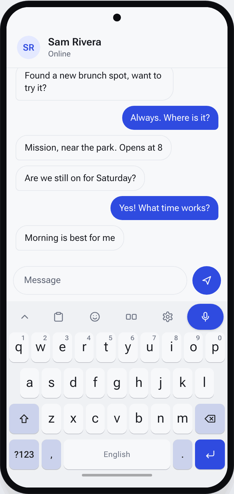
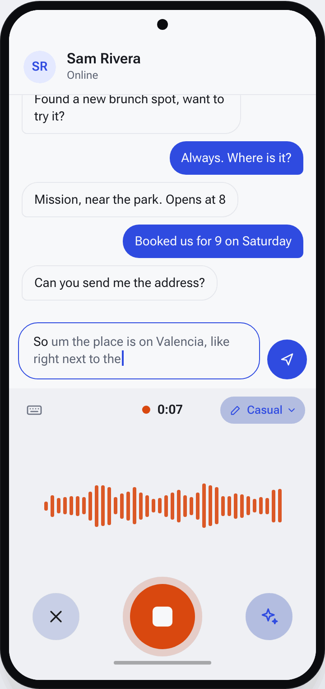
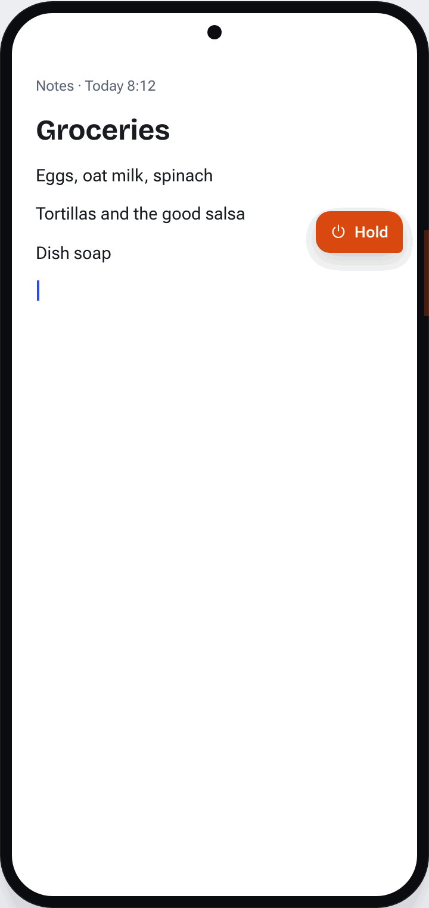
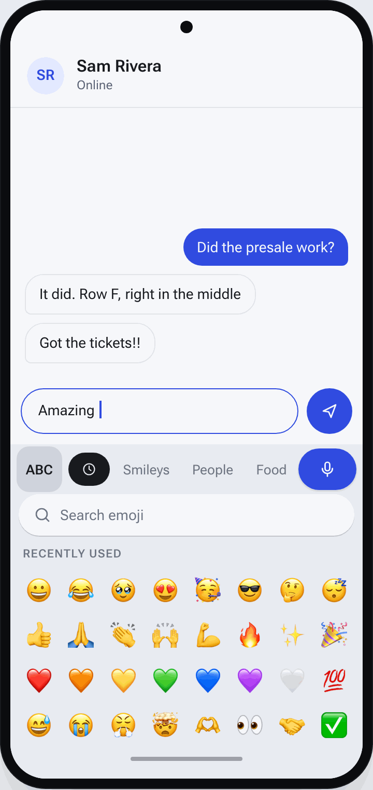
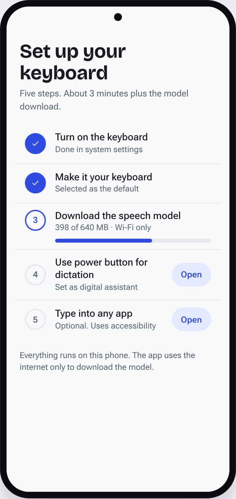
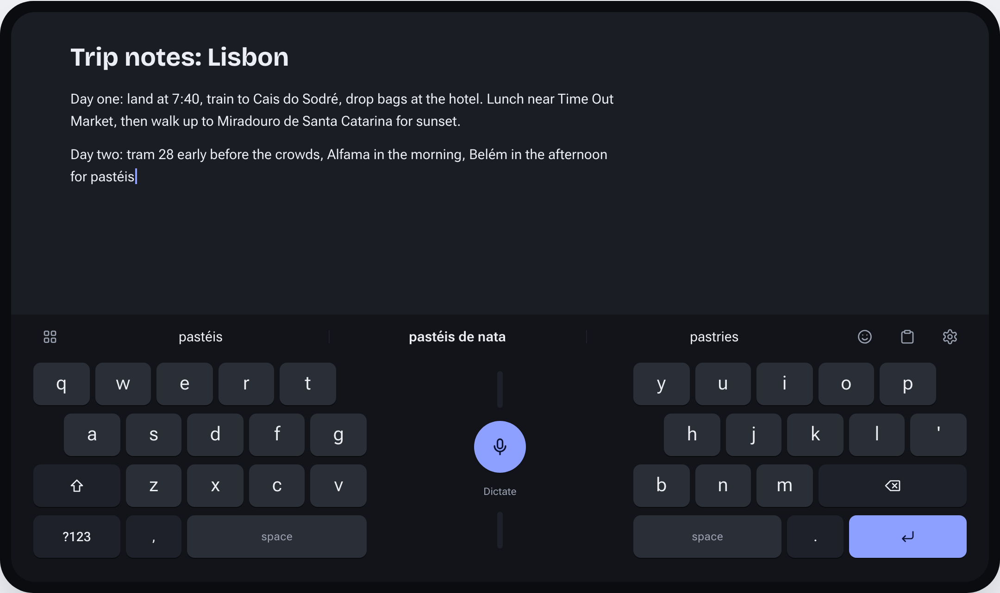

# Android Keyboard (working name)

A personal Android keyboard with on-device dictation. Speech runs locally with NVIDIA Parakeet TDT v3, the model [FluidVoice](https://github.com/altic-dev/FluidVoice) uses. Holding the power button starts dictation from any app.

**Status:** design done, Phase 0 (spike) next. See [PLAN.md](PLAN.md).

## Screens

These GIFs come from the mockups, not the app yet. From Phase 2 on, each one is replaced by a screen recording of the real build. The full board is in [`design/mockups.html`](design/mockups.html) ([online version](https://claude.ai/artifact/3c7LcyVueGcn2Z2qZ5Qbam)).

<table>
  <tr>
    <td align="center" width="33%"></td>
    <td align="center" width="33%"></td>
    <td align="center" width="33%"></td>
  </tr>
  <tr>
    <td><b>Keyboard</b><br>The dictation key stays at the right of the top strip in every state.</td>
    <td><b>Dictation</b><br>The keys swap for a listening panel. Cleaned-up text is typed straight away.</td>
    <td><b>Power button</b><br>Hold, speak, release. The text goes where you're typing, or to the clipboard.</td>
  </tr>
  <tr>
    <td align="center"></td>
    <td align="center"></td>
    <td></td>
  </tr>
  <tr>
    <td><b>Emoji and clipboard</b><br>Pinned clips stay. Others clear after 1 hour.</td>
    <td><b>Settings app</b><br>A setup checklist first, then every option in one place.</td>
    <td></td>
  </tr>
</table>



**Tablet:** in landscape the keys split into two thumb zones, with the dictation key in the middle.

## Features

- Full keyboard: suggestions, swipe typing, emoji, clipboard history with pins, themes, personal dictionary.
- Split layout for tablets in landscape.
- Dictation key with on-device Parakeet TDT v3 through [sherpa-onnx](https://github.com/k2-fsa/sherpa-onnx).
- Optional cleanup: removes filler words, applies dictionary replacements, and can rewrite with a small on-device model.
- Power-button dictation, by registering as the phone's digital assistant.
- Companion settings app for setup, the speech model, themes and the dictionary.

GIF search is left out for now. See [PLAN.md](PLAN.md) for why.

## Privacy

Speech never leaves the phone. Audio is held in memory and dropped after transcription. The app uses the internet only to download the speech model. It's built for personal use and installed directly from the APK, not the Play Store.

## Build and install

Filled in during Phase 1, once the HeliBoard fork is in place.

## Rebuilding the README GIFs

The GIFs are generated from the mockup page with Playwright:

```sh
pnpm --dir design/capture install
pnpm --dir design/capture capture
```

The output goes to `docs/media/`. Edit the frame list at the top of `design/capture/capture.mjs` to change which screens each GIF shows.

## License

GPL-3.0, inherited from [HeliBoard](https://github.com/Helium314/HeliBoard) once the fork lands.
